# ⚖️ Lab: Amazon EC2 Auto Scaling

> Laboratório prático de **Auto Scaling Group (ASG)** na AWS: um servidor de jogo que escala automaticamente conforme a demanda, se recupera de falhas e se prepara com antecedência para picos previsíveis de jogadores.

> *Ambiente de laboratório temporário — contas e credenciais exibidas nos prints foram destruídas ao final do lab.*

---

## 🎯 Objetivo

- Criar uma **AMI** a partir de um servidor configurado
- Criar um **Launch Template** como molde padronizado das instâncias
- Criar um **Auto Scaling Group** distribuído em duas zonas de disponibilidade
- Configurar **escalabilidade dinâmica** (target tracking por CPU, com alarmes do CloudWatch)
- Configurar **escalabilidade agendada** (scheduled action para pico previsível)
- Observar o ASG lançando instâncias e respeitando os limites de capacidade

---

## 🏗️ Arquitetura

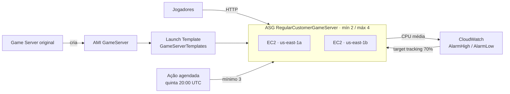

---

## 🧰 Serviços utilizados

| Serviço | Função no lab |
|---|---|
| Amazon EC2 | Servidores do jogo |
| AMI | Imagem base das instâncias |
| Launch Template | Molde versionado de configuração das instâncias |
| EC2 Auto Scaling | Ajuste automático da quantidade de instâncias |
| Amazon CloudWatch | Métricas de CPU e alarmes que disparam o scaling |
| Amazon VPC | Rede do lab, com sub-redes em duas AZs |

---

## 📚 Conceitos-chave

- **Escalabilidade horizontal:** adicionar/remover instâncias, em vez de aumentar uma só.
- **Capacidade mínima / desejada / máxima:** limites dentro dos quais o ASG opera.
- **Self-healing:** instância com falha no health check é substituída automaticamente.
- **Políticas de scaling:** dinâmica (reage a métricas) × agendada (antecipa horários conhecidos).

---

## 🛠️ Passo a passo

### 1. Acesso ao console

Acesso ao AWS Management Console com o usuário do ambiente de laboratório, na região **US East (N. Virginia) — us-east-1**.

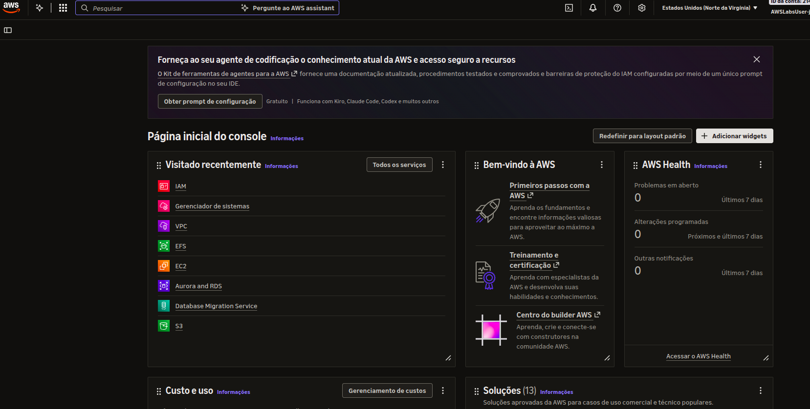

### 2. Instância base (Game Server)

O ambiente já provisiona uma instância EC2 que servirá de **modelo** para a AMI e, depois, para o Auto Scaling Group.

| Item | Valor | Por que importa |
|---|---|---|
| Tipo | `t3.micro` | Instância pequena, adequada a lab |
| VPC / sub-rede | `GameServerVPC` / sub-rede pública | Rede dedicada ao lab, com IP público para acesso HTTP |
| IAM role | Role associada à instância | Credenciais temporárias, sem chaves de acesso no servidor |
| IMDSv2 | **Required** | Protege o metadata da instância contra roubo de credenciais (SSRF) |
| Auto Scaling group | — | Ainda é uma instância avulsa; vira o "molde" do ASG |

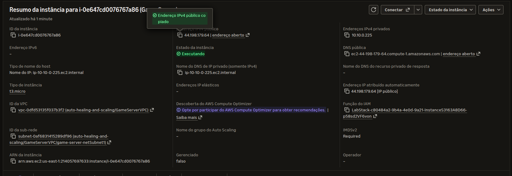

Teste de acesso via navegador, pelo IP público da instância (`http://<IP-público>`):

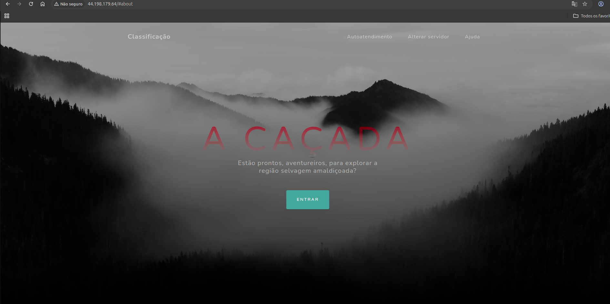

> O navegador marca **"Não seguro"** porque o acesso é via HTTP (porta 80), sem criptografia. Aceitável em lab; em produção, o tráfego passaria por um load balancer com certificado TLS (HTTPS).

### 3. Criação da AMI a partir da instância base

Com o servidor funcionando, foi criada uma **AMI (Amazon Machine Image)**: uma "foto" do disco e da configuração da instância. Toda nova instância do Auto Scaling Group nascerá idêntica a ela.

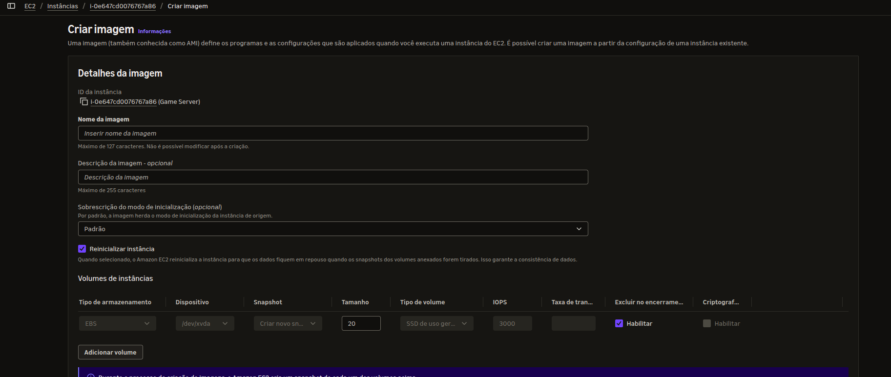

Pontos de atenção na criação:

- **Reinicializar instância:** a EC2 reinicia o servidor para tirar o snapshot com os dados em repouso, garantindo consistência (gera uma breve indisponibilidade).
- **Volume EBS (20 GiB, SSD de uso geral):** cada volume vira um **snapshot**, que fica armazenado (e é cobrado) mesmo depois que a instância for removida.
- **Excluir no encerramento:** o disco das novas instâncias é apagado quando elas forem terminadas — esperado em servidores descartáveis.
- **Criptografia:** não habilitada neste lab. Em produção, o ideal é usar volumes e AMIs **criptografados com KMS**.

> 🔐 **Segurança:** a AMI copia *tudo* que está no disco — arquivos de configuração, logs, histórico de comandos e eventuais segredos. Antes de gerar uma imagem, o servidor deve estar limpo, sem credenciais gravadas.

AMI `GameServer` criada com visibilidade **Privada** (acessível apenas pela própria conta). O status passa de **Pendente** para **Disponível** após alguns minutos, enquanto o snapshot do volume é gerado.

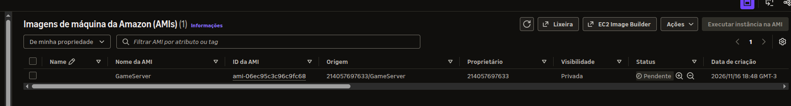

### 4. Launch Template (modelo de execução)

Com a AMI disponível, foi criado um **Launch Template**: o "molde" que o Auto Scaling Group usa para lançar cada nova instância, sem configuração manual uma a uma.

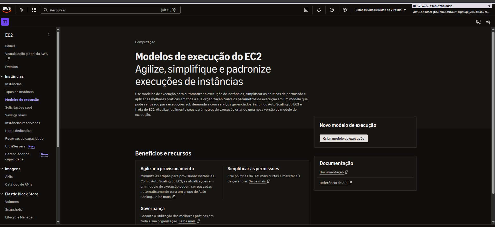

O Launch Template reúne em um só lugar AMI, tipo de instância, security group, par de chaves, IAM role e configurações avançadas. Ele é **versionado**: alterações geram uma nova versão, e o ASG pode ser apontado para ela — mudanças acontecem no molde, nunca direto nas instâncias.

**Nome e versão:** template `GameServerTemplates`, versão descrita como *Game server template*, com a **orientação para Auto Scaling** habilitada — o console sinaliza campos incompatíveis com o ASG.

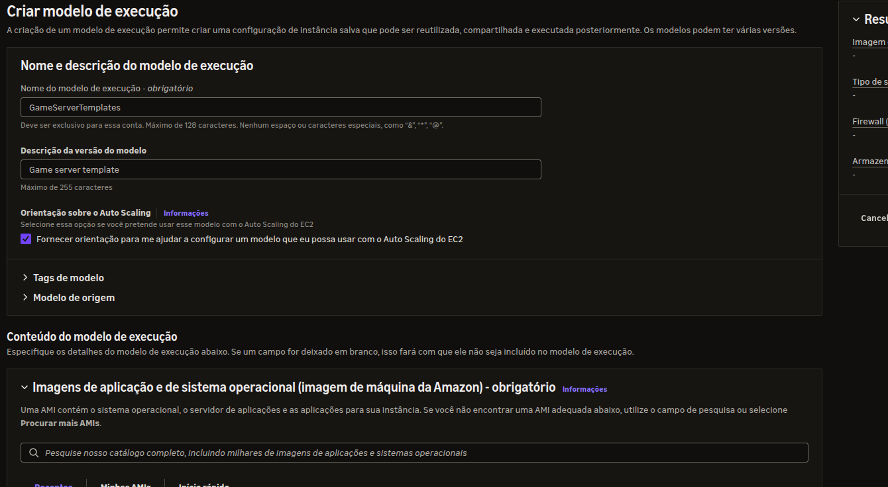

**AMI:** selecionada em *Minhas AMIs → De minha propriedade* a imagem `GameServer` (`ami-06ec95c3c96c9fc68`, x86_64), criada no passo anterior.

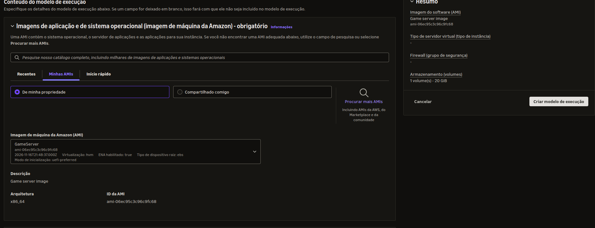

> 🔐 Usar uma AMI própria (ou oficial da AWS) evita o risco de AMIs públicas da comunidade, que podem conter software desatualizado ou malicioso.

**Tipo de instância:** `t3.micro`.

**Par de chaves:** criado o par `GameServerPair` (RSA, formato `.pem` para OpenSSH), conforme o roteiro do lab.

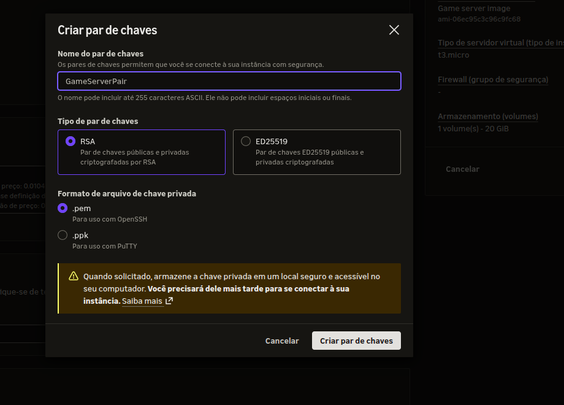

> 🔐 **Cuidados com a chave privada:**
> - A AWS entrega o `.pem` **uma única vez** — se perder, não há como baixar de novo.
> - Permissão restrita no Linux/macOS: `chmod 400 GameServerPair.pem` (o SSH recusa chaves com permissões abertas).
> - **Nunca** versionar a chave no Git — o repositório tem `*.pem` no `.gitignore`.
> - Em produção, a alternativa preferível é o **AWS Systems Manager Session Manager**: acesso ao terminal sem chaves e sem porta 22 aberta, com sessões auditadas.

**Security group:** selecionado o grupo existente `WebServerSecurityGroup`, na mesma VPC do lab (`GameServerVPC`). As sub-redes ficam a cargo do Auto Scaling Group, que distribui as instâncias entre zonas de disponibilidade.

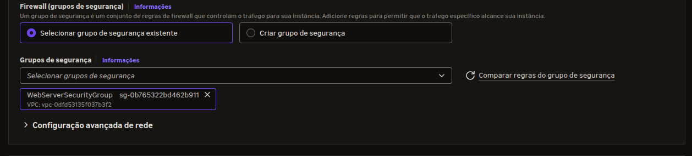

**Resumo do template:**

| Item | Configuração |
|---|---|
| AMI | `GameServer` (`ami-06ec95c3c96c9fc68`) |
| Tipo de instância | `t3.micro` |
| Security group | `WebServerSecurityGroup` |
| Armazenamento | 1 volume EBS de 20 GiB |
| Par de chaves | `GameServerPair` |

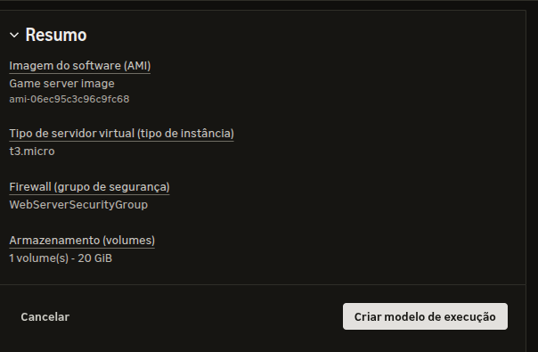

O template fica salvo e pode ser **reutilizado**: para lançar instâncias avulsas, como base do Auto Scaling Group ou como origem de uma **nova versão** (ex.: trocar o tipo de instância sem refazer toda a configuração).

### 5. Auto Scaling Group

Etapa que conecta todas as peças: o ASG usa o **Launch Template** (que aponta para a **AMI**) para criar e manter as instâncias, distribuídas entre zonas de disponibilidade e ajustadas automaticamente conforme a demanda.

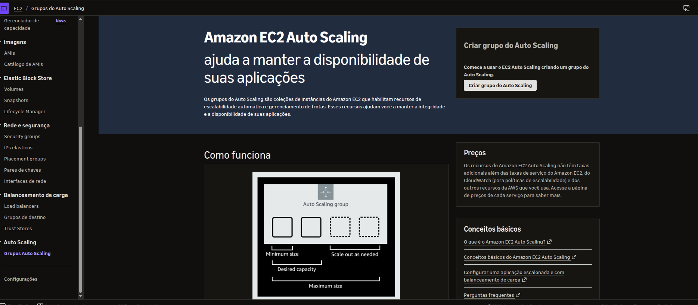

O ASG trabalha com três limites de capacidade:

- **Mínimo:** quantidade que sempre fica em execução, mesmo sem demanda.
- **Desejada:** quantidade que o ASG mantém agora (ajustada pelas políticas de scaling).
- **Máximo:** teto de instâncias — também funciona como **limite de custo**.

O serviço não tem custo próprio: paga-se apenas pelas instâncias EC2 e pelos alarmes do CloudWatch usados nas políticas.

**Etapa 1 — Nome e modelo de execução:** grupo `RegularCustomerGameServer`, usando o template `GameServerTemplates` na versão **Default (1)**. O console confirma o que será herdado: AMI `GameServer`, `t3.micro`, par de chaves `GameServerPair` e o security group do template.

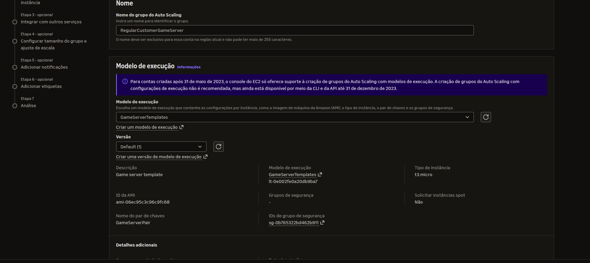

> 💡 *Launch Configurations* (formato antigo) não são mais suportadas para novas contas — o padrão atual é o **Launch Template**, que tem versionamento.

**Etapa 2 — Rede:** VPC `GameServerVPC` (`10.10.0.0/16`) com duas sub-redes em **zonas de disponibilidade diferentes**:

| Sub-rede | AZ | CIDR |
|---|---|---|
| `game-server-netSubnet1` | us-east-1a (`use1-az1`) | `10.10.0.0/24` |
| `game-server-netSubnet2` | us-east-1b (`use1-az2`) | `10.10.1.0/24` |

Distribuição entre AZs: **Melhor esforço equilibrado** — se o lançamento falhar em uma zona, o ASG tenta na outra zona íntegra, priorizando manter a aplicação no ar.

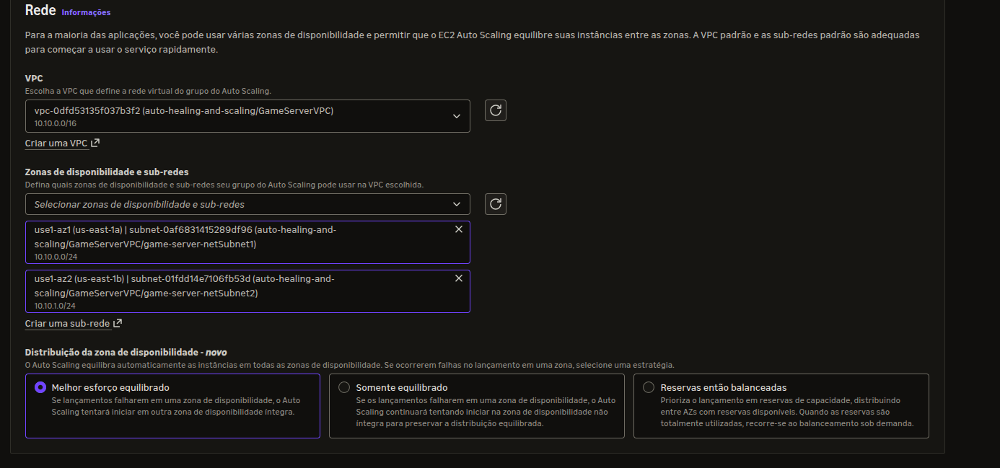

> 🏗️ **Alta disponibilidade:** com instâncias em duas AZs (data centers fisicamente separados), a falha de uma zona inteira não derruba o serviço.

**Etapa 3 — Verificações de integridade (health checks):**

- **EC2 health check:** sempre habilitado — verifica se a instância (hardware/sistema) está saudável. Instância não íntegra é **substituída automaticamente** (self-healing).
- **ELB health check:** indisponível, pois este grupo não usa load balancer.
- **Período de tolerância:** `240 segundos` — tempo para a instância inicializar e subir o servidor de jogo antes da primeira avaliação, evitando que o ASG encerre instâncias que ainda estão ligando.

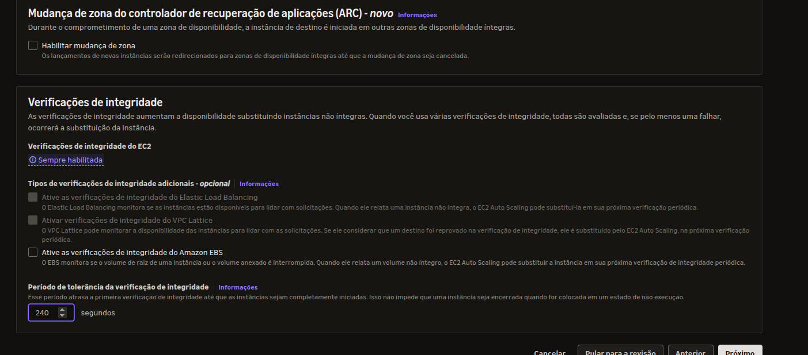

> ⚠️ **Limitação observada:** o health check de EC2 avalia a *máquina*, não a *aplicação*. Se o servidor de jogo travar com a instância ligada, ela continua "saudável". Com um **Application Load Balancer** e health check do tipo **ELB**, o ASG passaria a substituir instâncias cuja aplicação parou de responder.

**Etapa 4 — Tamanho do grupo:**

| Parâmetro | Valor | Significado |
|---|---|---|
| Capacidade mínima | 2 | Nunca menos que 2 servidores — um por AZ |
| Capacidade desejada | 2 | Quantidade mantida no momento |
| Capacidade máxima | 4 | Teto de crescimento — também limita o custo |

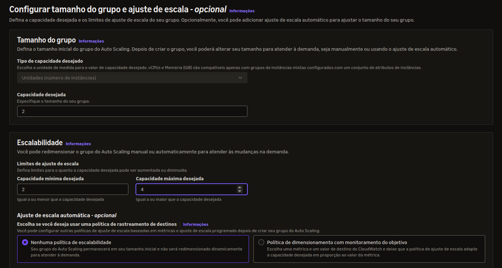

### 6. Histórico de atividades — o ASG em ação

Logo após a criação, a aba **Atividade** registra o ASG lançando as instâncias por conta própria:

| Instância | Status | Causa |
|---|---|---|
| `i-03b416d9e1101f108` | Ainda não está em serviço | Capacidade desejada alterada de 0 para 2 |
| `i-05ca0ce9a2a4d1964` | Ainda não está em serviço | Capacidade desejada alterada de 0 para 2 |

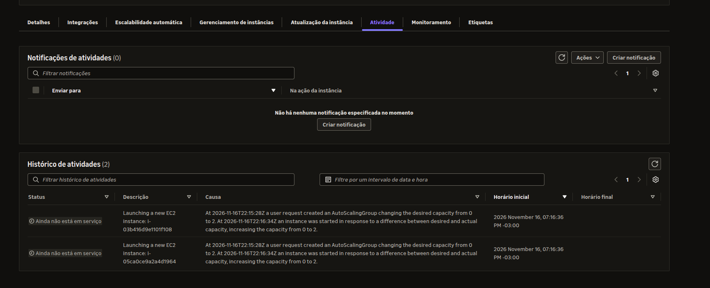

O campo **Causa** mostra a lógica central do Auto Scaling: o grupo compara constantemente a **capacidade desejada** com a **capacidade real** e corrige a diferença. Aqui, desejado = 2 e real = 0 → duas instâncias lançadas. É o mesmo mecanismo que recria instâncias com falha.

O status **"Ainda não está em serviço"** indica que as instâncias estão inicializando, dentro do período de tolerância do health check.

> 🔐 O histórico de atividades funciona como **trilha de auditoria** do ASG: registra *o que* aconteceu e *por quê*. Para saber *quem* alterou a configuração do grupo, a fonte é o **AWS CloudTrail**.

### 7. Política de escalabilidade (target tracking)

Política **CPU Utilization**, do tipo **monitoramento do objetivo (target tracking)**:

| Parâmetro | Valor |
|---|---|
| Métrica | Média de utilização de CPU do grupo |
| Valor-alvo | **70%** |
| Ação | Adicionar ou remover instâncias conforme necessário |
| Aquecimento (warmup) | 300 segundos |
| Scale-in (redução) | Habilitado |

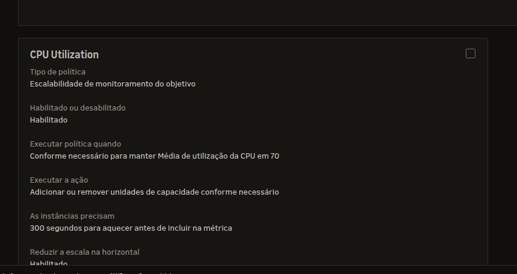

Funciona como um **termostato**: o ASG ajusta a quantidade de instâncias para manter a CPU média próxima de 70%, sempre dentro dos limites de **2 a 4** instâncias.

- **Alvo de 70%:** deixa 30% de folga para absorver picos enquanto novas instâncias inicializam.
- **Warmup de 300 s:** a instância nova só entra no cálculo da média após 5 minutos, evitando decisões baseadas em uma máquina que ainda está ligando.

### 8. Ação agendada (scheduled scaling)

Para o pico **previsível** de jogadores, foi criada a ação agendada `SecondWaveOfRegulars`:

| Parâmetro | Valor |
|---|---|
| Recorrência (cron) | `0 20 * * Thu` — toda quinta-feira às 20:00 UTC (17:00 em Brasília) |
| Início | 26/11/2026 |
| Fuso horário | `Etc/UTC` |
| Capacidade desejada / mín. / máx. | 3 / 3 / 4 |

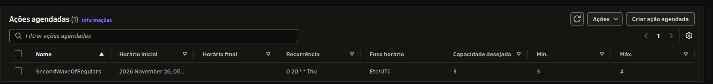

Lendo o cron `0 20 * * Thu`:

```
0    20   *    *    Thu
│    │    │    │    └── dia da semana: quinta-feira
│    │    │    └─────── mês: todos
│    │    └──────────── dia do mês: todos
│    └───────────────── hora: 20 (UTC)
└────────────────────── minuto: 0
```

A ação **eleva o mínimo de 2 para 3** antes da segunda onda de jogadores — a capacidade já está pronta quando o pico chega, em vez de reagir a ele. A política de CPU continua ativa e pode levar o grupo até 4.

| | Target tracking (CPU) | Ação agendada |
|---|---|---|
| Gatilho | Métrica do CloudWatch | Data/horário |
| Ideal para | Picos imprevisíveis | Picos previsíveis |
| Comportamento | Reage à carga | Antecipa a carga |

### 9. Instâncias em execução

| Instância | Origem | AZ | Status |
|---|---|---|---|
| `i-0e647cd0076767a86` (Game Server) | Criada manualmente — base da AMI | us-east-1a | ✅ 3/3 verificações |
| `i-03b416d9e1101f108` | **Auto Scaling Group** | us-east-1a | ✅ 3/3 verificações |
| `i-05ca0ce9a2a4d1964` | **Auto Scaling Group** | us-east-1b | ✅ 3/3 verificações |

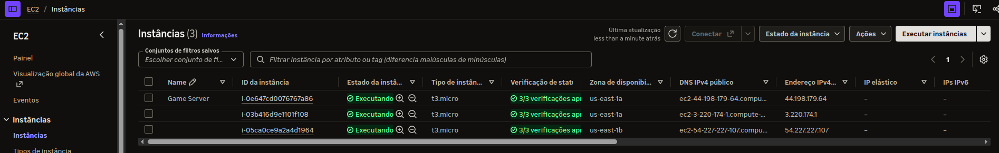

As duas instâncias do ASG foram distribuídas **uma em cada zona de disponibilidade**, como configurado. Ambas nasceram da AMI `GameServer`, com o mesmo tipo e security group, sem nenhuma configuração manual. A Game Server original continua fora do grupo — se ela falhar, ninguém a substitui.

### 10. Alarmes do CloudWatch

A política de target tracking criou **automaticamente** dois alarmes no CloudWatch:

| Alarme | Condição | Ação |
|---|---|---|
| `TargetTracking-...-AlarmHigh` | CPU **> 70%** por 3 pontos de dados em **3 minutos** | Scale-out (adiciona instâncias) |
| `TargetTracking-...-AlarmLow` | CPU **abaixo do limiar** por 15 pontos de dados em **15 minutos** | Scale-in (remove instâncias) |

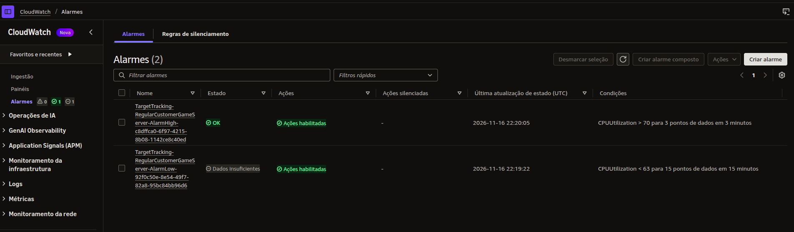

- **Assimetria proposital:** escalar para fora leva ~3 min; escalar para dentro, ~15 min. A AWS prefere sobrar capacidade por um tempo a remover um servidor e precisar dele logo em seguida.
- **Limiar de baixa abaixo de 70%:** a margem entre os dois alarmes evita o *flapping* — o grupo ficar adicionando e removendo instâncias sem parar quando a CPU oscila perto do alvo.
- Esses alarmes pertencem à política e **não devem ser editados ou excluídos manualmente**.

**Gráfico do AlarmHigh:** a linha vermelha marca o limiar de 70%; a CPU real do grupo (linha azul) está em ~0,2% — servidores ociosos. A barra de estado mostra a transição de *Dados insuficientes* para **OK** assim que as instâncias começaram a enviar métricas.

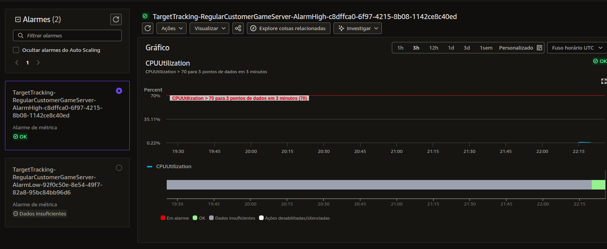

**AlarmLow em alarme:** após 15 minutos de servidores ociosos, o alarme de baixa disparou — a política "pediu" para remover instâncias. Mesmo assim, **nenhuma instância foi encerrada**: o grupo já está na **capacidade mínima (2)**, e o ASG nunca reduz abaixo desse limite.

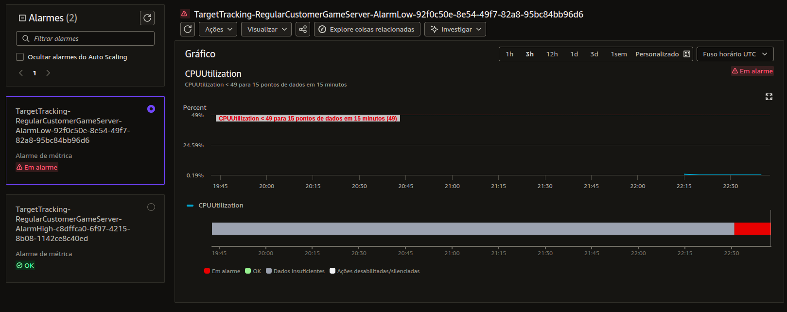

> 💡 O limiar do AlarmLow mudou de 63% para 49% sem intervenção manual — os alarmes de target tracking são **gerenciados pela política**, que ajusta seus parâmetros automaticamente.

---

## ✅ Resultados

- ✅ AMI e Launch Template criados a partir de um servidor configurado
- ✅ ASG lançou **2 instâncias sozinho**, uma em cada AZ, a partir do molde
- ✅ Política de CPU criou e passou a avaliar os alarmes no CloudWatch
- ✅ Alarme de redução disparou, mas o ASG **respeitou o mínimo de 2** instâncias
- ✅ Ação agendada configurada para antecipar o pico de quinta-feira

---

## 🔐 Boas práticas de segurança observadas

- **IMDSv2 obrigatório** na instância base (proteção contra roubo de credenciais via SSRF)
- **AMI privada**, sem compartilhamento público
- **Launch Template** como fonte única e versionada de configuração — mudanças no molde, não na instância
- **Chave `.pem` fora do repositório** (`*.pem` no `.gitignore`)
- **Capacidade máxima** como barreira de custo (*denial of wallet*)
- **Histórico de atividades** + **CloudTrail** como trilha de auditoria

---

## 🚀 O que eu melhoraria

| Melhoria | Motivo |
|---|---|
| **Teste de carga** com `stress-ng` nas duas instâncias do ASG | Validar o scale-out na prática (AlarmHigh → 3ª instância). Não executado: o ambiente do lab expirou antes do teste |
| **Application Load Balancer** + health check **ELB** | Distribuir jogadores e substituir instâncias cuja *aplicação* travou, não só a máquina |
| **HTTPS** com certificado do ACM no load balancer | Eliminar o tráfego em HTTP puro ("Não seguro") |
| **IAM role e IMDSv2** definidos no Launch Template | A AMI copia o disco, mas não essas configurações da instância — as instâncias do ASG precisam herdá-las do template |
| **Session Manager** no lugar do par de chaves | Acesso sem chave e sem porta 22, com sessões auditadas |
| **Ação agendada de retorno** (mínimo volta a 2 após o pico) | Sem ela, o mínimo fica em 3 permanentemente, pagando um servidor ocioso |
| **Tag `Name`** propagada pelo ASG | Instâncias do grupo aparecem sem nome — dificulta inventário e resposta a incidentes |
| **Criptografia KMS** em volumes e AMIs | Proteção dos dados em repouso |
| **Logs no CloudWatch Logs** | No scale-in, a instância é destruída junto com os logs locais |

---

## 🧹 Limpeza

O ambiente do lab é destruído automaticamente. Em uma conta própria, a ordem seria:

1. **Excluir o Auto Scaling Group** — termina as instâncias do grupo e remove políticas, alarmes de target tracking e ações agendadas. ⚠️ Terminar só as instâncias não adianta: o ASG as recria.
2. **Excluir o Launch Template** `GameServerTemplates`
3. **Cancelar o registro da AMI** `GameServer` **e excluir o snapshot** associado (o snapshot continua cobrando sozinho)
4. **Terminar a instância** Game Server original
5. **Excluir o par de chaves** `GameServerPair`

---

## 💡 Aprendizados

- O ASG funciona comparando **capacidade desejada × real** e corrigindo a diferença — todo o resto (self-healing, scaling) deriva disso.
- **Mínimo** protege a disponibilidade; **máximo** protege o orçamento.
- **Target tracking** reage a cargas imprevisíveis; **ações agendadas** antecipam as previsíveis — os dois convivem no mesmo grupo.
- A escolha da métrica muda o comportamento: com **média** de CPU, uma única instância sobrecarregada pode não disparar o scale-out.
- O health check de EC2 não enxerga a aplicação — disponibilidade real exige olhar a camada da aplicação.
- Um erro no molde (AMI ou template) se replica em **todas** as instâncias: segurança precisa estar no molde.
