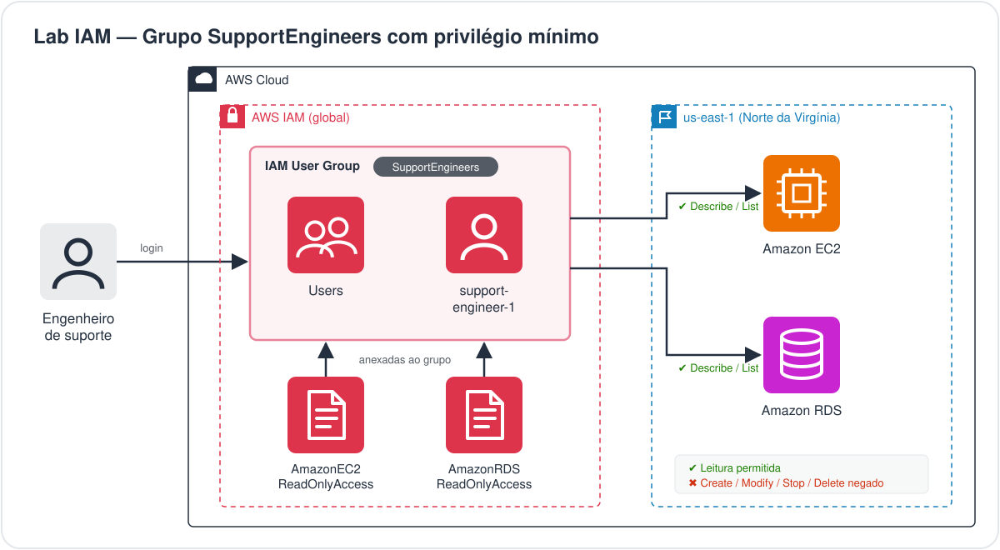

# 🔐 AWS IAM Lab — Grupos com Privilégio Mínimo para Engenheiros de Suporte

> Laboratório prático de **controle de acesso na AWS**, com foco em dois pilares da segurança da informação: **autenticação** e **autorização**. Usa **IAM User Groups** e **políticas gerenciadas** com o princípio do **menor privilégio**.
> Parte do meu portfólio de estudos para **AWS Cloud Practitioner (CLF-C02)** e carreira em **segurança em nuvem**.

---

## 📌 Cenário

Uma empresa tem uma equipe de **engenheiros de suporte** que precisa **consultar** instâncias EC2 e bancos RDS para diagnosticar problemas, mas **não pode alterar, criar ou excluir** nada.

**Solicitação:** implementar grupos IAM com permissões de privilégio mínimo para controlar o acesso desses engenheiros aos recursos AWS.

## 🔑 Pilares de segurança: autenticação e autorização

Este laboratório é construído sobre dois pilares do controle de acesso, que respondem a perguntas diferentes:

| | 🪪 Autenticação | 🛂 Autorização |
|---|---|---|
| **Pergunta** | *Quem é você?* | *O que você pode fazer?* |
| **Analogia** | Mostrar o crachá na portaria | As salas que o crachá abre |
| **No IAM** | Identidade + credencial (usuário IAM, senha do console, MFA) | Políticas JSON anexadas ao grupo, avaliadas a cada chamada de API |
| **Neste lab** | Criação do usuário `support-engineer-1` com senha de console e login com essa identidade | Grupo `SupportEngineers` com `AmazonEC2ReadOnlyAccess` e `AmazonRDSReadOnlyAccess` |
| **Evidência** | Console exibindo `support-engineer-1` como identidade ativa ([etapa 06](docs/06-validar-acesso.md)) | Leitura permitida e ações de alteração negadas ([etapas 06](docs/06-validar-acesso.md) e [08](docs/08-validar-rds.md)) |

**Ponto-chave:** autenticar com sucesso **não** significa ter acesso. O `support-engineer-1` entrou no console normalmente (autenticação ✅), mas foi bloqueado ao tentar encerrar uma instância EC2 ou criar um banco RDS (autorização ❌). A mensagem de erro deixa os dois pilares visíveis: ela identifica **quem** é o usuário (`user/support-engineer-1`) e informa que ele **não está autorizado** (`is not authorized to perform`).

## 🎯 Objetivo

- Criar um **grupo IAM** (`SupportEngineers`) para centralizar permissões
- Anexar **políticas gerenciadas pela AWS** somente de leitura
- Criar o usuário `support-engineer-1` e adicioná-lo ao grupo
- **Validar** que o usuário consegue ler, mas não modificar recursos

## 🏗️ Arquitetura

**Fluxo:** o engenheiro faz login como `support-engineer-1` → herda as permissões do grupo `SupportEngineers` → as políticas gerenciadas liberam apenas ações de leitura (`Describe*`, `List*`) em EC2 e RDS → qualquer tentativa de criar, alterar, parar ou excluir recursos é negada.

## 🧰 Serviços e componentes

| Componente | Função no lab |
|---|---|
| IAM User Group | Agrupa os engenheiros e concentra as permissões |
| IAM User | Identidade individual de cada engenheiro |
| `AmazonEC2ReadOnlyAccess` | Política gerenciada: leitura em EC2 |
| `AmazonRDSReadOnlyAccess` | Política gerenciada: leitura em RDS |
| Amazon EC2 / Amazon RDS | Recursos que o grupo acessa |

## 📋 Etapas

| # | Etapa | Documentação |
|---|---|---|
| 01 | Visão geral da solução | [docs/01-visao-geral.md](docs/01-visao-geral.md) |
| 02 | Acesso ao Console da AWS | [docs/02-acesso-console.md](docs/02-acesso-console.md) |
| 03 | Console do IAM | [docs/03-console-iam.md](docs/03-console-iam.md) |
| 04 | Criação do grupo `SupportEngineers` | [docs/04-criar-grupo.md](docs/04-criar-grupo.md) |
| 05 | Criação do usuário `support-engineer-1` | [docs/05-criar-usuario.md](docs/05-criar-usuario.md) |
| 06 | Login e validação de acesso | [docs/06-validar-acesso.md](docs/06-validar-acesso.md) |
| 07 | Concessão de acesso ao RDS | [docs/07-acesso-rds.md](docs/07-acesso-rds.md) |
| 08 | Validação do acesso ao RDS | [docs/08-validar-rds.md](docs/08-validar-rds.md) |

## 🛡️ Decisões de segurança

- **Permissões no grupo, não no usuário:** novos engenheiros herdam o acesso só por entrar no grupo, e o acesso é removido ao tirá-los do grupo.
- **Somente leitura:** o suporte diagnostica, mas não altera o ambiente (menor privilégio).
- **Políticas gerenciadas pela AWS:** mantidas pela própria AWS e atualizadas quando surgem novas ações de leitura.

## ✅ Checklist de segurança

- [x] Nenhuma permissão anexada diretamente ao usuário (tudo herdado do grupo)
- [x] Apenas políticas de leitura no grupo
- [x] Nenhuma access key criada para o usuário
- [x] Testes de ação negada documentados (EC2 e RDS)
- [ ] MFA no usuário: não aplicado no lab, recomendado para produção
- [ ] Troca de senha no primeiro login: não aplicada no lab, recomendada para produção

> Os prints foram mantidos sem ocultação porque a conta do laboratório é temporária e foi destruída ao final.

## 📚 O que aprendi

- **Autenticar não é o mesmo que ser autorizado.** O `support-engineer-1` entrou no console normalmente, mas foi bloqueado em toda ação fora das políticas do grupo.
- **Deny implícito x deny explícito.** Eu achava que uma política de leitura "negava" as ações de escrita. Na verdade, ela só não as permite: é um deny implícito, que qualquer `Allow` de outro grupo pode derrubar. Só um `Deny` explícito vence tudo.
- **Grupos facilitam corrigir erros.** Esqueci de anexar a política do RDS na criação do grupo. A correção foi feita no grupo, e o usuário recebeu o acesso automaticamente, sem nenhuma alteração nele.
- **Ler a mensagem de erro é investigar.** O erro de acesso negado mostra quem tentou, qual ação, em qual recurso e o motivo.
- **Atenção à região.** O IAM é global, mas EC2 e RDS são regionais. Na região errada, a lista de recursos aparece vazia.

## 🚀 Próximos passos

- Trocar as políticas gerenciadas por uma **política customizada** restrita a recursos específicos (por tag ou ARN)
- Exigir **MFA** via condição na política
- Migrar o acesso humano para o **IAM Identity Center**
- Completar a tríade **AAA** com o terceiro pilar, **auditoria** (*accounting*): registrar e analisar as tentativas de acesso negadas com o **AWS CloudTrail**

## 🔗 Referências

- [Documentação do IAM](https://docs.aws.amazon.com/IAM/latest/UserGuide/introduction.html)
- [Grupos de usuários do IAM](https://docs.aws.amazon.com/IAM/latest/UserGuide/id_groups.html)
- [Boas práticas de segurança no IAM](https://docs.aws.amazon.com/IAM/latest/UserGuide/best-practices.html)

---

**Lab realizado no AWS Skill Builder.**
**Autor:** Lucas Barbosa Santos — Tecnólogo em Segurança da Informação (em andamento)
