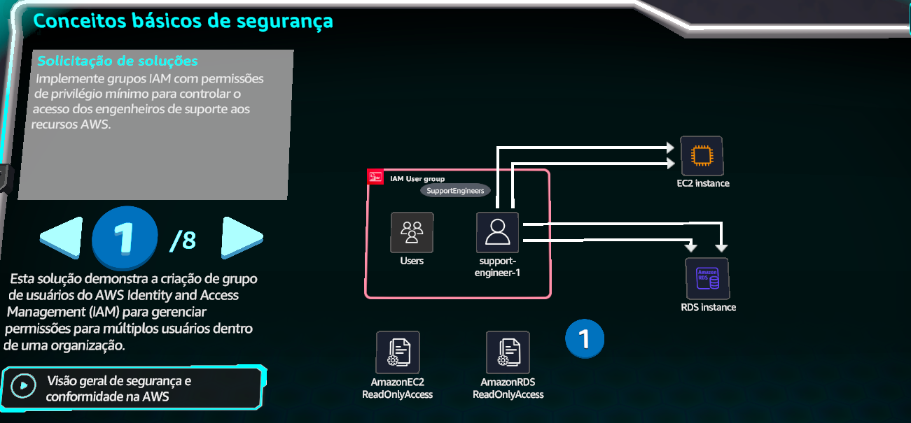

# 01 — Visão geral da solução

## Objetivo

Entender a arquitetura antes de colocar a mão na massa: um **grupo de usuários IAM** que concentra as permissões de leitura para a equipe de suporte.

## O que a solução propõe

- **Grupo:** `SupportEngineers`
- **Usuário:** `support-engineer-1`, membro do grupo
- **Políticas anexadas ao grupo:**
  - `AmazonEC2ReadOnlyAccess`: consultar instâncias EC2
  - `AmazonRDSReadOnlyAccess`: consultar instâncias RDS

## Por que usar grupo em vez de permissão direta no usuário?

Com 1 engenheiro, tanto faz. Com 50, anexar política usuário por usuário vira bagunça, e alguém acaba com permissão a mais esquecida. No grupo, a permissão fica em **um único lugar**:

| Ação | Como fazer |
|---|---|
| Entrou um engenheiro novo | Adicionar ao grupo |
| Engenheiro saiu da equipe | Remover do grupo |
| Mudou a regra de acesso | Alterar a política do grupo, e todos são afetados |

## Pontos de segurança

- Um grupo **não é uma identidade**: ninguém faz login "como grupo". Ele só distribui permissões.
- Um usuário pode estar em vários grupos, e as permissões **se somam**.
- Políticas `ReadOnly` gerenciadas pela AWS são práticas, mas valem para **todos** os recursos EC2/RDS da conta. Em produção, o ideal é restringir por tag ou ARN.

[⬅ Voltar ao README](../README.md)
