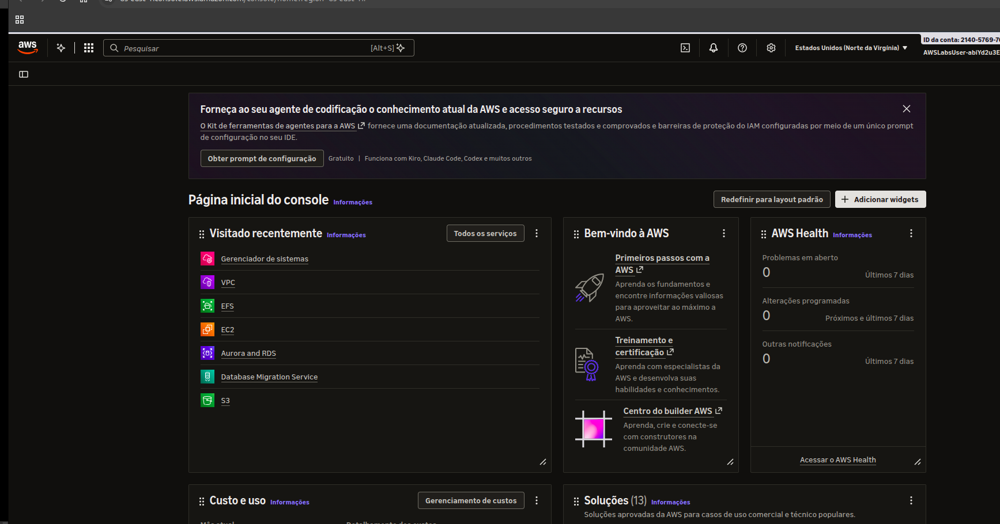

# 02 — Acesso ao Console da AWS

## Objetivo

Entrar no AWS Management Console do ambiente de laboratório e conferir a região antes de começar.

## O que foi feito

- Login no console com o usuário fornecido pelo laboratório (`AWSLabsUser`)
- Conferência da região ativa: **Estados Unidos (Norte da Virgínia) — `us-east-1`**

## Pontos de atenção

- **IAM é um serviço global:** usuários, grupos e políticas valem para todas as regiões. Ao abrir o IAM, o seletor de região mostra "Global".
- **EC2 e RDS são regionais:** as instâncias que o grupo vai consultar existem em uma região específica. Se o seletor estiver em outra região, a lista aparece vazia, mesmo com as permissões corretas.

## Pontos de segurança

- O acesso foi feito com um **usuário do laboratório**, não com o usuário root. Em uma conta real, o root deve ficar protegido com MFA e fora do uso diário.
- Ambiente temporário: a conta é destruída ao final do laboratório.

[⬅ Voltar ao README](../README.md)
