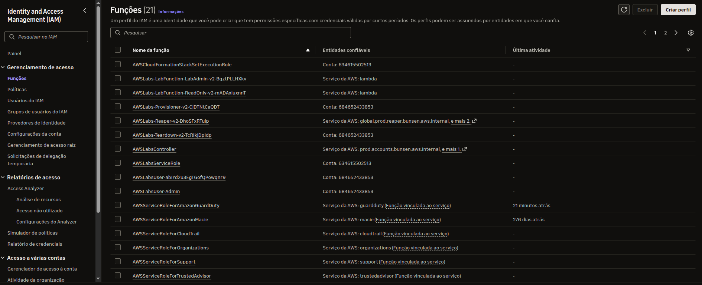

# 03 — Console do IAM

## Objetivo

Acessar o serviço **Identity and Access Management (IAM)** e reconhecer as identidades que já existem na conta antes de criar novas.

## O que foi feito

- Abertura do console do IAM
- Análise da seção **Funções** (*Roles*), que lista as roles existentes na conta

## O que a tela mostra

| Coluna | Significado |
|---|---|
| Nome da função | Nome da role |
| Entidades confiáveis | **Quem pode assumir** a role: uma conta, um serviço da AWS (ex.: Lambda) ou um provedor de identidade |
| Última atividade | Quando a role foi usada pela última vez |

Tipos de role identificados na conta:

- **Roles de serviço** (ex.: confiança em `lambda`): permitem que um serviço da AWS aja em nome da conta.
- **Roles entre contas** (confiança em `Conta: <ID>`): permitem que outra conta AWS assuma a role. É assim que o ambiente do laboratório é provisionado.
- **Service-linked roles** (`AWSServiceRoleFor...`): criadas e gerenciadas pela própria AWS para serviços como GuardDuty, CloudTrail e Trusted Advisor.

> 💡 O próprio usuário do laboratório (`AWSLabsUser-...`) é uma **role**, não um usuário IAM. O acesso ao console foi feito **assumindo uma role** com credenciais temporárias, que é o modelo recomendado pela AWS para acesso humano.

## Pontos de segurança

- **Revisar a coluna "Última atividade"** ajuda a encontrar roles sem uso, candidatas a remoção (menos identidades = menor superfície de ataque).
- **Entidades confiáveis** são tão importantes quanto as permissões: uma role com permissões mínimas, mas que confia em qualquer conta, continua sendo um risco.
- Service-linked roles não devem ser editadas manualmente; a AWS controla suas permissões.

[⬅ Voltar ao README](../README.md)
