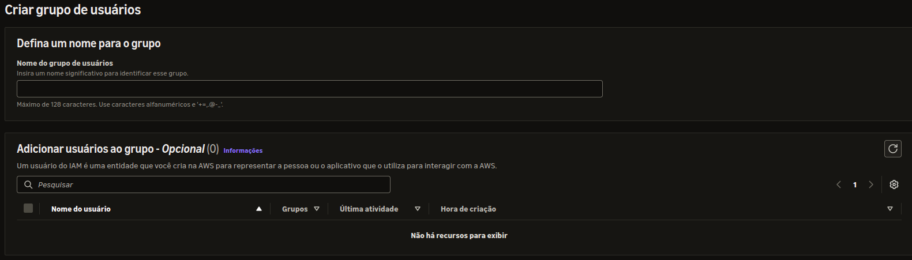
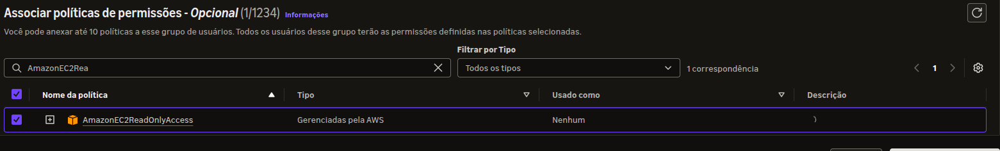

# 04 — Criação do grupo `SupportEngineers`

## Objetivo

Criar o grupo de usuários que vai concentrar as permissões de leitura da equipe de suporte. O grupo é criado **antes** dos usuários, para que cada novo engenheiro já entre recebendo o acesso correto.

## O que foi feito

1. Console do IAM → **Grupos de usuários** → **Criar grupo**
2. Definição do nome do grupo

3. Na seção **Associar políticas de permissões**, busca e seleção da política gerenciada pela AWS `AmazonEC2ReadOnlyAccess`

| Campo | Valor | Significado |
|---|---|---|
| Tipo | Gerenciadas pela AWS | Criada e mantida pela AWS |
| Usado como | Nenhum | Ainda não está anexada a nenhuma identidade nesta conta |

4. Grupo criado com a política `AmazonEC2ReadOnlyAccess`

> ⚠️ **Lacuna identificada na revisão:** a política `AmazonRDSReadOnlyAccess` não foi selecionada na criação do grupo. A correção foi feita na [etapa 07](07-acesso-rds.md), anexando a política ao grupo, sem alterar o usuário.

## Pontos de atenção

- **Nome significativo:** o nome deve indicar a função da equipe (`SupportEngineers`), não uma pessoa. Grupos representam papéis, não indivíduos.
- **Adicionar usuários é opcional** na criação: a conta ainda não tem usuários IAM, então o grupo nasce vazio e recebe membros depois.

## Pontos de segurança

- Um grupo aceita **no máximo 10 políticas gerenciadas** anexadas. Precisar de mais que isso é sinal de que o grupo está acumulando funções demais.
- Criar o grupo primeiro evita a tentação de anexar políticas direto no usuário "só para testar".

[⬅ Voltar ao README](../README.md)
