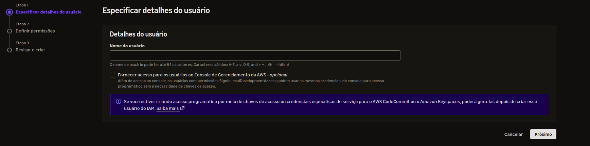
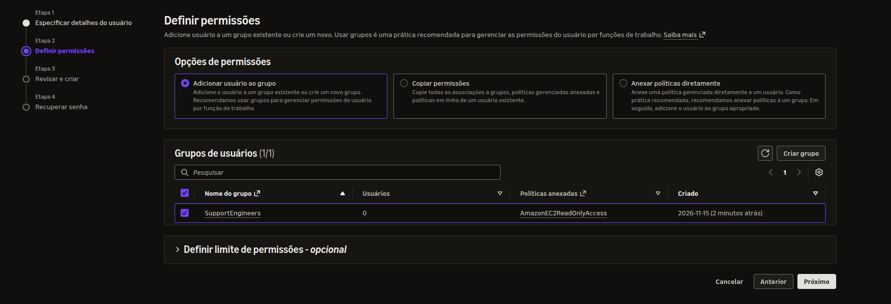
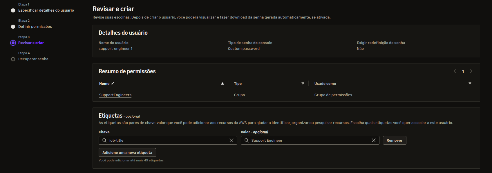
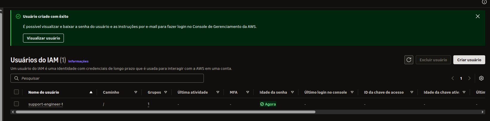

# 05 — Criação do usuário `support-engineer-1`

## Objetivo

Criar a identidade individual do engenheiro de suporte e incluí-la no grupo `SupportEngineers`, **sem anexar permissões diretamente ao usuário**.

## O que foi feito

1. Console do IAM → **Usuários** → **Criar usuário**
2. **Etapa 1 — Especificar detalhes do usuário:** definição do nome do usuário

3. **Etapa 2 — Definir permissões:** opção **Adicionar usuário ao grupo**, com o grupo `SupportEngineers` selecionado

Das três opções disponíveis, a escolhida foi a recomendada pela própria AWS:

| Opção | Quando usar | Usada? |
|---|---|---|
| Adicionar usuário ao grupo | Permissões por função de trabalho | ✅ |
| Copiar permissões | Replicar grupos e políticas de outro usuário | ❌ pode copiar acessos indevidos junto |
| Anexar políticas diretamente | Exceções pontuais | ❌ dificulta auditoria |

4. **Etapa 3 — Revisar e criar:** conferência dos dados e adição de uma etiqueta (tag) para organização

| Item revisado | Valor |
|---|---|
| Nome do usuário | `support-engineer-1` |
| Tipo de senha do console | Senha personalizada |
| Exigir redefinição de senha | Não |
| Permissões | Herdadas do grupo `SupportEngineers` |
| Etiqueta | `job-title` = `Support Engineer` |

5. Usuário criado com sucesso

## Resultado

| Coluna | Valor | Leitura |
|---|---|---|
| Grupos | 1 | Membro do `SupportEngineers` |
| MFA | — | Sem MFA configurado |
| Idade da senha | Agora | Senha recém-criada |
| ID da chave de acesso | — | Nenhuma access key (como planejado) |

## O assistente de criação

| Etapa | O que define |
|---|---|
| 1. Especificar detalhes | Nome e se o usuário terá acesso ao console |
| 2. Definir permissões | Grupo, cópia de outro usuário ou políticas diretas |
| 3. Revisar e criar | Conferência final |

## Pontos de segurança

- **Access keys não são criadas aqui.** A AWS só permite gerá-las depois que o usuário existe, o que evita criar credenciais programáticas sem necessidade. O engenheiro de suporte só consulta recursos pelo console, então **não precisa de access keys**.
- **MFA não configurado.** Em ambiente real, todo usuário com acesso ao console deve ter MFA, e uma política com a condição `aws:MultiFactorAuthPresent` pode negar ações a quem não estiver autenticado com MFA.
- **Exigir redefinição de senha: Não.** Aceitável no laboratório, mas em produção o ideal é **exigir a troca no primeiro login**, para que o administrador que criou a conta não conheça a senha final do usuário.
- **Etiquetas (tags)** organizam e facilitam a busca e o rastreio de custos. Também permitem o **ABAC** (*attribute-based access control*): políticas que liberam acesso com base em tags, como "só pode gerenciar recursos com a mesma tag `team` que o usuário".
- **Limite de permissões (permissions boundary)** não foi usado. Ele define o **teto máximo** de permissões de um usuário, mesmo que um grupo conceda mais. É útil quando outras pessoas podem adicionar o usuário a grupos.
- **Acesso ao console é opcional:** só deve ser habilitado se a pessoa realmente vai usar o navegador. Cada forma de acesso habilitada é mais uma credencial para proteger.

[⬅ Voltar ao README](../README.md)
