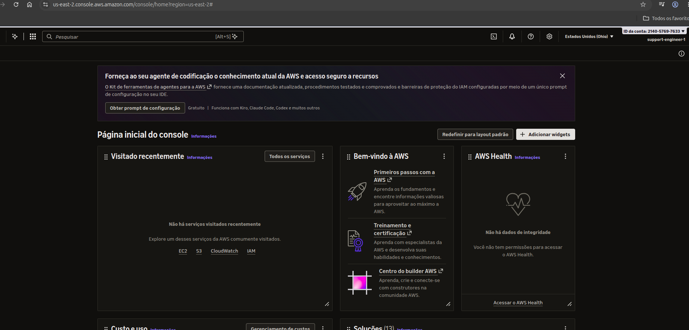
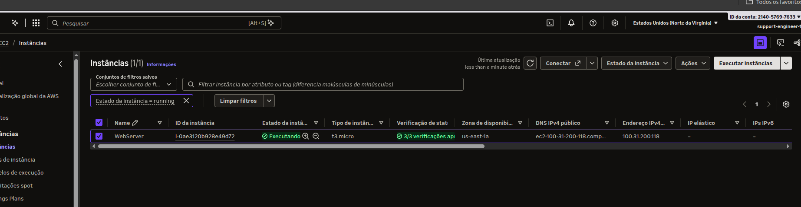
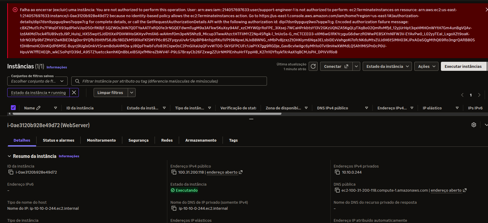

# 06 — Login como `support-engineer-1` e validação de acesso

## Objetivo

Entrar no console com o novo usuário e comprovar, na prática, que ele **consegue ler** recursos de EC2 e RDS, mas **não consegue alterar** nada nem acessar outros serviços.

## O que foi feito

1. Login no console com o usuário `support-engineer-1` (canto superior direito mostra a identidade ativa)

### Primeira evidência de menor privilégio

O widget **AWS Health** exibe: *"Você não tem permissões para acessar o AWS Health"*.

O grupo `SupportEngineers` não possui nenhuma política que libere o AWS Health. Como tudo na AWS começa **negado por padrão (deny implícito)**, o acesso é bloqueado sem que seja preciso escrever nenhuma regra de `Deny`.

2. Troca da região para **Norte da Virgínia (`us-east-1`)** e acesso a **EC2 → Instâncias**

### ✅ Teste 1 — Leitura no EC2: **permitida**

O usuário consegue listar e visualizar os detalhes da instância:

| Atributo | Valor |
|---|---|
| Nome | WebServer |
| Tipo | t3.micro |
| Estado | Executando |
| Zona de disponibilidade | us-east-1a |

Isso comprova que a política `AmazonEC2ReadOnlyAccess`, herdada do grupo `SupportEngineers`, está funcionando (ações `ec2:Describe*`).

> Os botões **Estado da instância**, **Ações** e **Executar instâncias** continuam visíveis no console. O console não esconde botões com base em permissões; o bloqueio acontece **no momento da chamada à API**.

3. Tentativa de **encerrar (terminate)** a instância `WebServer`: **Estado da instância → Encerrar instância**

### ❌ Teste 2 — Encerrar instância: **negado**

Anatomia da mensagem de erro:

| Trecho da mensagem | O que significa |
|---|---|
| `User: arn:aws:iam::<conta>:user/support-engineer-1` | **Quem** tentou (principal) |
| `is not authorized to perform: ec2:TerminateInstances` | **Qual ação** foi bloqueada |
| `on resource: arn:aws:ec2:us-east-1:<conta>:instance/i-0ae3...` | **Em qual recurso** |
| `because no identity-based policy allows ...` | **Por quê:** nenhuma política concede essa ação |

O trecho *"no identity-based policy allows"* indica um **deny implícito**: não existe nenhum `Deny` escrito, apenas a ausência de um `Allow`. Seguindo a ordem de avaliação do IAM:

1. Há `Deny` explícito? **Não**
2. Há `Allow` para `ec2:TerminateInstances`? **Não** (a política só libera `Describe*`, `Get*`, `List*`)
3. Resultado: **negado por padrão** ✅

Se o bloqueio viesse de um `Deny` explícito, a mensagem diria *"with an explicit deny in an identity-based policy"*.

> A **mensagem de falha codificada** no fim do erro pode ser decodificada com `aws sts decode-authorization-message`, por quem tiver a permissão `sts:DecodeAuthorizationMessage`. Ela traz o contexto completo da avaliação e é útil para troubleshooting.

## Pontos de segurança

- A instância continuou **Executando** após a tentativa: o bloqueio impediu uma ação **destrutiva e irreversível**, exatamente o objetivo do menor privilégio.
- A mensagem de erro é detalhada (usuário, ação, recurso). Ela fica registrada no **CloudTrail**, o que permite auditar tentativas de acesso indevido.

## Pontos de atenção

- **Região:** após o login, o console abriu em **Estados Unidos (Ohio) — `us-east-2`**. Os recursos do laboratório estão em `us-east-1`; é preciso trocar a região para enxergá-los.

[⬅ Voltar ao README](../README.md)
