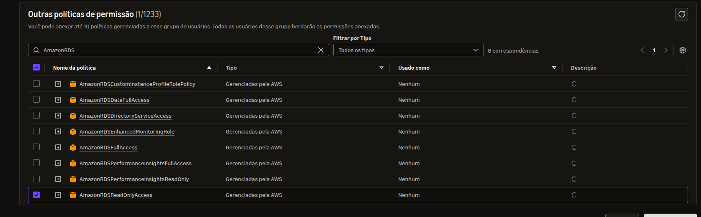
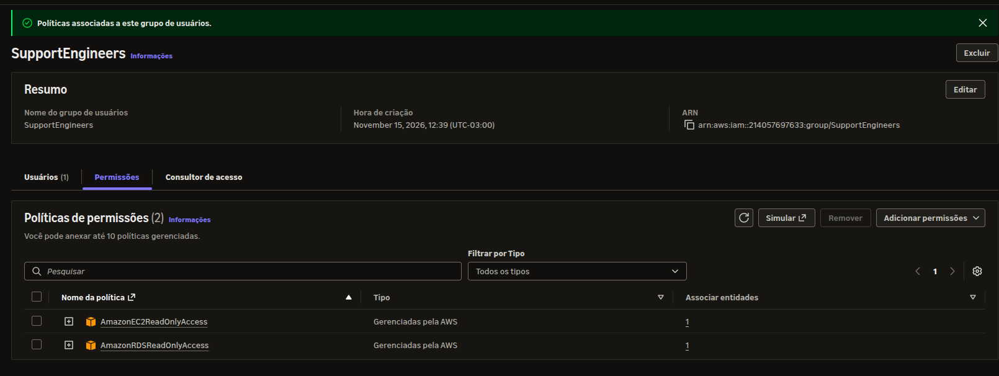

# 07 — Concessão de acesso de leitura ao RDS

## Objetivo

Corrigir uma lacuna identificada na revisão: o grupo `SupportEngineers` foi criado apenas com a política de EC2, e a política `AmazonRDSReadOnlyAccess` precisava ser adicionada.

## O que foi feito

1. De volta à conta administrativa do laboratório: **Grupos de usuários → SupportEngineers → aba Permissões → Adicionar permissões → Anexar políticas**
2. Busca por `AmazonRDS` e seleção da política `AmazonRDSReadOnlyAccess`

3. Políticas associadas com sucesso: o grupo passa a ter as **duas** políticas previstas na arquitetura

| Política | Tipo | Entidades associadas |
|---|---|---|
| `AmazonEC2ReadOnlyAccess` | Gerenciada pela AWS | 1 (grupo `SupportEngineers`) |
| `AmazonRDSReadOnlyAccess` | Gerenciada pela AWS | 1 (grupo `SupportEngineers`) |

O usuário `support-engineer-1` herda a nova permissão **automaticamente**, sem nenhuma alteração no próprio usuário.

> A aba **Consultor de acesso** (*Access Advisor*) mostra quais serviços os membros do grupo realmente usaram e quando. É a ferramenta para revisar periodicamente se alguma permissão concedida nunca é usada e pode ser removida.

## Escolhendo a política certa

A busca por `AmazonRDS` retorna **8 políticas gerenciadas** com nomes parecidos, e escolher a errada pode conceder muito mais acesso que o necessário:

| Política | Nível de acesso | Adequada ao suporte? |
|---|---|---|
| `AmazonRDSReadOnlyAccess` | Somente leitura | ✅ |
| `AmazonRDSFullAccess` | Controle total do RDS | ❌ |
| `AmazonRDSDataFullAccess` | Executar consultas SQL via Data API | ❌ |
| `AmazonRDSPerformanceInsightsReadOnly` | Leitura de métricas de desempenho | Não pedida no cenário |

## Pontos de segurança

- A correção foi feita **no grupo**, não no usuário. Assim, **todos os membros atuais e futuros** recebem o acesso, sem precisar alterar usuário por usuário.
- **Atenção a nomes parecidos:** `ReadOnly` x `FullAccess` está a um clique de distância. Antes de anexar, vale abrir o JSON (`+`) e conferir as ações liberadas.

[⬅ Voltar ao README](../README.md)
