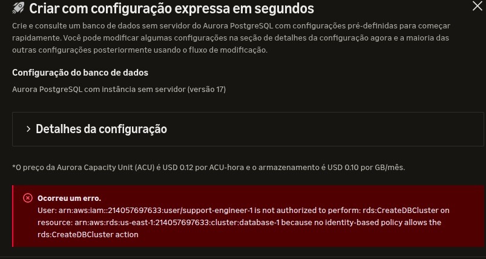

# 08 — Validação do acesso ao RDS

## Objetivo

Confirmar, logado como `support-engineer-1`, que a política `AmazonRDSReadOnlyAccess` (adicionada na [etapa 07](07-acesso-rds.md)) permite consultar o RDS, mas **não permite criar ou alterar** recursos.

## O que foi feito

1. Login como `support-engineer-1`, região **`us-east-1`**, console do **Amazon RDS**
2. Como o ambiente do laboratório não possui banco de dados provisionado, foi feita uma tentativa de **criar** um banco (Aurora PostgreSQL sem servidor, configuração expressa)

### ❌ Teste 3 — Criar banco de dados no RDS: **negado**

| Trecho da mensagem | O que significa |
|---|---|
| `User: ...:user/support-engineer-1` | Quem tentou |
| `is not authorized to perform: rds:CreateDBCluster` | Ação bloqueada: criar um cluster |
| `on resource: arn:aws:rds:us-east-1:...:cluster:database-1` | Recurso que seria criado |
| `because no identity-based policy allows ...` | **Deny implícito**: a política só libera ações de leitura |

O mesmo padrão do teste no EC2 se repete: a `AmazonRDSReadOnlyAccess` libera ações como `rds:Describe*` e `rds:List*`, mas nenhuma ação de criação, modificação ou exclusão.

### Leitura no RDS

O ambiente do laboratório não possui banco de dados provisionado, por isso a listagem de bancos não foi registrada como evidência. A leitura é concedida pela política `AmazonRDSReadOnlyAccess`, confirmada no grupo na [etapa 07](07-acesso-rds.md).

## Resultado final dos testes

| # | Teste | Serviço | Resultado esperado | Resultado obtido |
|---|---|---|---|---|
| 1 | Listar instâncias | EC2 | ✅ Permitido | ✅ Permitido |
| 2 | Encerrar instância | EC2 | ❌ Negado | ❌ Negado |
| 3 | Criar banco de dados | RDS | ❌ Negado | ❌ Negado |
| — | Acessar AWS Health | Health | ❌ Negado | ❌ Negado |

Todos os resultados correspondem ao esperado: o grupo `SupportEngineers` concede **somente leitura** em EC2 e RDS, e qualquer outra ação é bloqueada por deny implícito.

## Pontos de segurança

- **Proteção também contra custo:** a própria tela informa o preço do Aurora Serverless (cobrança por ACU-hora e por GB armazenado). Uma permissão ampla demais permitiria que qualquer membro do grupo criasse recursos pagos. Menor privilégio também é **controle de custos**.
- A tentativa negada fica registrada no **CloudTrail** com o código de erro `AccessDenied`.

[⬅ Voltar ao README](../README.md)
