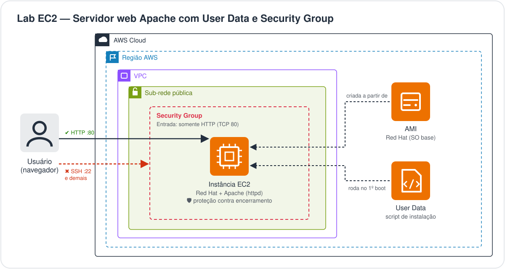

# 🖥️ Gerenciando uma EC2

> Laboratório prático de **Amazon EC2**: criação de uma instância com servidor web Apache instalado automaticamente via **User Data**, **proteção contra encerramento** e **Security Group** liberando acesso HTTP.
> Parte do meu portfólio de estudos para **AWS Cloud Practitioner (CLF-C02)**.

  

---

## 🔎 Uma visão geral do EC2

Em resumo, o **Amazon Elastic Compute Cloud** (ou, para os íntimos, Amazon EC2 😙) é um serviço da AWS (Amazon Web Services) onde você pode usar força computacional sob demanda.

Você, através da internet, pode ter acesso a um computador muito mais potente que o seu (😴) sem precisar estar com ele fisicamente. Imagina poder jogar aquele jogo pesado diretamente do seu "PC da xuxa"?! Ter uma internet boa já é o suficiente para você ter acesso a esse serviço da AWS.

> [!NOTE]
> **Mas o que "força computacional sob demanda" quer dizer?**
> Quer dizer que você liga a máquina quando precisa, desliga quando não precisa e paga só pelo tempo de uso. Nada de comprar servidor e deixar ele parado num canto!

---

## 🎯 Objetivos do Laboratório

- [x] Criar uma instância EC2 com Red Hat Enterprise Linux
- [x] Ativar a **proteção contra encerramento** da instância
- [x] Instalar e iniciar um servidor web Apache automaticamente com **User Data**
- [x] Configurar o **Security Group** para permitir acesso HTTP (porta 80)
- [x] Validar que a instância está em execução

## 🏗️ Arquitetura

**Fluxo:** o usuário acessa o site pela internet → o **Security Group** só deixa passar tráfego HTTP na porta 80 → a requisição chega na **instância EC2**, criada a partir de uma **AMI** do Red Hat, onde o **Apache** foi instalado pelo script de **User Data**.

## 🧰 Serviços e componentes

| Componente | Função no lab |
|---|---|
| Amazon EC2 | A máquina virtual (instância) que roda o servidor web |
| AMI (Red Hat) | O "molde" do disco: sistema operacional e softwares base |
| Tipo de instância | O "hardware" virtual: vCPU, memória e rede |
| VPC e sub-rede | A rede privada onde a instância fica e a faixa de IPs de onde vem o endereço dela |
| Security Group | O firewall da instância, que define quem pode entrar e sair |
| User Data | Script que roda no primeiro boot e instala o Apache |

## 📋 Etapas

| # | Etapa | Documentação |
|---|---|---|
| 01 | Formas de acessar a AWS | [docs/01-formas-de-acesso.md](docs/01-formas-de-acesso.md) |
| 02 | Criando a instância (AMI e tipo de instância) | [docs/02-criar-instancia.md](docs/02-criar-instancia.md) |
| 03 | Rede e proteção contra encerramento | [docs/03-rede-e-protecao.md](docs/03-rede-e-protecao.md) |
| 04 | Automação com User Data | [docs/04-user-data.md](docs/04-user-data.md) |
| 05 | Validação da instância | [docs/05-validacao.md](docs/05-validacao.md) |
| 06 | Regras de segurança (Security Group) | [docs/06-security-group.md](docs/06-security-group.md) |

## 🛡️ Checklist de segurança

- [x] Proteção contra encerramento ativada
- [x] Security Group liberando **apenas** a porta 80 para entrada
- [x] Nenhuma porta de administração (SSH 22 / RDP 3389) aberta para a internet
- [x] Nenhuma senha ou chave dentro do script de User Data
- [ ] HTTPS (porta 443) no lugar de HTTP: não aplicado no lab, recomendado para produção

## 📚 O que aprendi

- **AMI não é o mesmo que tipo de instância.** A AMI é o "pendrive de instalação" (sistema + softwares); o tipo de instância é o "computador" onde ele roda (CPU, memória, rede).
- **User Data automatiza a configuração.** Em vez de instalar o Apache na mão, um script faz tudo no primeiro boot.
- **Security Group nasce fechado para entrada.** Toda entrada é negada por padrão e toda saída é liberada; só entra o que eu libero explicitamente.
- **Liberar `0.0.0.0/0` depende da porta.** Para um site público (80/443) é normal; para portas de administração (22/3389), nunca.

## 🚀 Próximos passos

- Monitorar a instância com o **CloudWatch** (CPU, rede, verificações de status)
- **Redimensionar** a instância, trocando o tipo de instância sem perder o disco
- **Testar** a proteção contra encerramento, tentando encerrar a instância
- Acessar a instância pelo **Session Manager**, sem abrir a porta 22
- **Encerrar** a instância ao final, desativando a proteção primeiro

## 🔗 Referências

- [Documentação do Amazon EC2](https://docs.aws.amazon.com/ec2/)
- [Security Groups do EC2](https://docs.aws.amazon.com/AWSEC2/latest/UserGuide/ec2-security-groups.html)
- [User Data no EC2](https://docs.aws.amazon.com/AWSEC2/latest/UserGuide/user-data.html)

---

**Autor:** Lucas Barbosa Santos — Tecnólogo em Segurança da Informação (em andamento)
